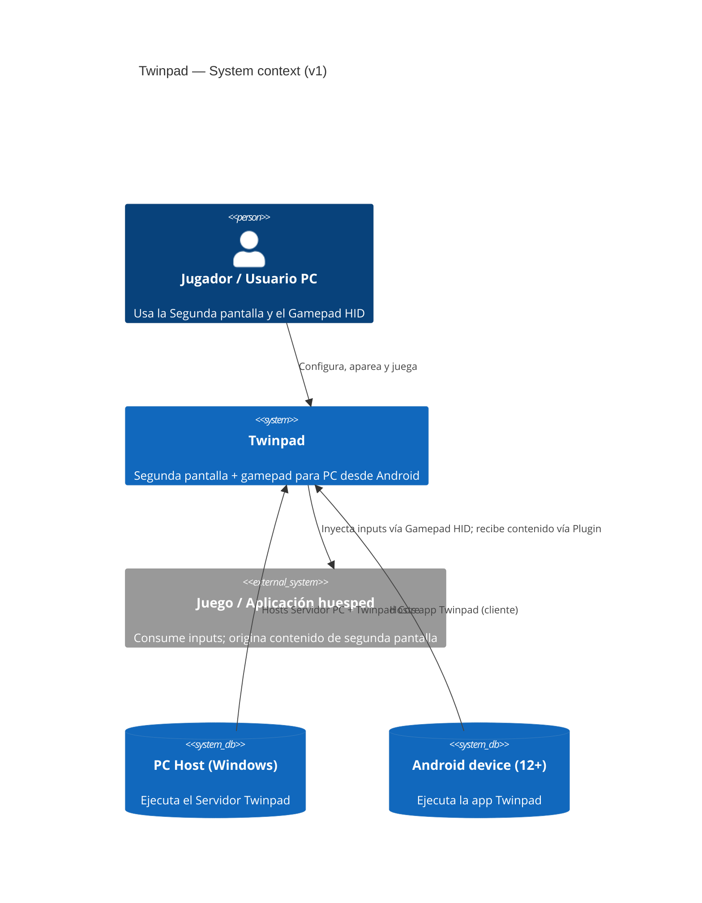

# Architecture — Twinpad

> ⚠️ TEMPLATE — replace every `<placeholder>`, delete guidance blocks (`> 💡 …`) before `Approved`.

> **What this is:** the system-level structure: components, responsibilities, boundaries, and the technical decisions with system-wide reach.
> **What it is NOT:** detailed design of a SPEC (see `design/`) or why a specific choice was made (see `decisions/` — reference ADRs here).

| | |
|---|---|
| ID | ARCH |
| Version | 0.1.0 |
| Status | Draft |
| Owner | Twinpad team |
| Last updated | 2026-10-07 |

## 1. System context

> 💡 The system as a black box: what surrounds it. Users, external systems, protocols. One diagram (C4 level 1) + short prose. Use actor names from `product/context.md` §5.

Twinpad conecta el **PC Host** (Windows, con juegos/aplicaciones) con el **Android device** (celular del usuario) sobre **WiFi LAN** y/o **Bluetooth**. El **Jugador** aparea ambos con un QR. Los juegos integran Twinpad vía **Plugin** (SDK o Config externa). El sistema NO opera fuera de la red local (v1).

## 2. Components and responsibilities

> 💡 One row per component with a single crisp responsibility. If you cannot state the responsibility in one sentence, the decomposition is wrong.

| Component | Responsibility | Type | Specs served |
|---|---|---|---|
| `Servidor PC` | Gestionar sesiones, exponer el QR de vinculación y coordinar los streams | service (persistente) | REQ-001, REQ-002 |
| `Twinpad Core (PC)` | Ejecutar transporte LAN/Bluetooth, captura de framebuffer/audio e inyección de inputs | module (Rust) | REQ-003, REQ-004, REQ-005 |
| `SDK Twinpad` | Permitir a un juego anunciar contenido de segunda pantalla y recibir inputs | lib | REQ-006 |
| `Cargador de Config externa` | Cargar y validar configuraciones de juegos no integrados | module (Rust) | REQ-007 |
| `App Twinpad (Android)` | Mostrar la Segunda pantalla y capturar inputs táctiles/físicos | app (Kotlin) | REQ-004, REQ-008 |
| `Motor HID (Android)` | Presentar el celular como Gamepad HID vía Bluetooth y codificar inputs al descriptor | module (Kotlin+Rust) | REQ-003 |
| `Captura (PC)` | Capturar framebuffers y audio del juego integrado | module (Rust) | REQ-004, REQ-005 |

## 3. Boundaries and dependencies

> 💡 What may depend on what. Direction rules prevent cycles. State allowed and forbidden dependencies explicitly — this is what agents must respect.

| From | To | Allowed via | Forbidden |
|---|---|---|---|
| `App Twinpad (Android)` | `Twinpad Core (PC)` | Protocolo de sesión (transporte) | Acceso directo a captura del PC |
| `Motor HID (Android)` | `App Twinpad (Android)` | Interfaz interna de inputs | Conocer el juego o su contenido |
| `SDK Twinpad` | `Servidor PC` | API de anuncio/registro del juego | Escribir directo en la red/transporte |
| `Cargador de Config externa` | `Twinpad Core (PC)` | Modelo de configuración validado | Ejecutar código del juego |
| `Twinpad Core (PC)` | `Servidor PC` | Eventos internos de sesión | Depender del juego concreto |
| `Captura (PC)` | `Twinpad Core (PC)` | Stream de frames/audio | Renderizado o lógica de UI |

Regla transversal: ningún componente del lado PC importa código de Android y viceversa; la única frontera es el protocolo de sesión (ver §4).

## 4. Communication

> 💡 How components talk: sync (RPC), async (streams), plus failure semantics (timeouts, retries, idempotency, ordering guarantees). Contract formats are referenced, not duplicated (see SPEC §12 style).

| Interaction | Style | Contract | Failure semantics |
|---|---|---|---|
| `Android → Servidor PC` (pairing) | sync handshake | Payload del QR + challenge (SPEC del pairing) | QR expirado → rechazo; reintentos con backoff |
| `PC → Android` (Segunda pantalla) | stream continuo | Contrato de Framebuffer (SPEC del stream) | Corte de red → recuperar stream sin re-pairing (REQ-005 AC-2) |
| `PC → Android` (audio) | stream continuo | Contrato de audio (SPEC del stream) | Jitter buffer; pérdida tolerada |
| `Android → PC` (inputs HID) | stream de eventos | Signature HID (CTX-C5) | Eventos idempotentes por secuencia; descarte de duplicados |
| `PC → Android` (vibración) | evento | Contrato de rumble (SPEC HID) | Fire-and-forget con mejor esfuerzo |
| `Juego → Servidor PC` (SDK) | API local in-process | API del SDK (SPEC del SDK) | Juego crashea → sesión sigue activa |

## 5. Persistence

> 💡 Which component owns which data. Ownership (single writer) is an architectural rule; detailed schemas live in `design/` or the data store itself.

| Data | Owner | Store | Notes |
|---|---|---|---|
| Perfiles de controles táctiles | `App Twinpad (Android)` | almacenamiento local Android | PII: ninguna; exportables |
| Configs externas de juegos | `Cargador de Config externa` | archivos locales en PC | Comunidad/usuario |
| Tokens/sesiones de pairing | `Servidor PC` | almacén local cifrado | Retención corta; revocable |

## 6. Integrations

> 💡 Every external system, with the failure story. If an integration has no failure semantics, that is an open question.

| External system | Purpose | Direction | Contract | Failure behavior |
|---|---|---|---|---|
| Juego / Aplicación huesped (con SDK) | Contenido de segunda pantalla + inputs | inbound/outbound | API del SDK Twinpad | Juego cae → sesión continúa sin segunda pantalla |
| Juego sin integración (vía Config externa) | Solo inputs (gamepad estándar) | inbound | Signature HID | Sin captura de pantalla garantizada |
| SO Windows (HID) | Registrar el Gamepad HID | outbound | Driver/HID del sistema | Sin registro → juego no ve el control |
| Router WiFi LAN / Bluetooth | Transporte | — | CTX-C2 | Degradación por señal; reconexión automática |

## 7. Security

> 💡 System-wide security posture: authN/authZ model, secrets handling, encryption. Requirement-specific rules live in REQs/SPECs.

| Aspect | Decision | ADR |
|---|---|---|
| authN | Solo dispositivos con token del QR (NFR-004) | ADR-004 |
| Cifrado del transporte | Sí (detalle en SPEC del protocolo de sesión) | - |
| Secrets | Token de sesión derivado del QR; nunca en logs | - |
| Superficie de red | Servidor solo accesible en LAN local | CTX-C2 |

## 8. Scalability and performance

> 💡 Horizontal/vertical strategy, stateless vs stateful components, scaling limits, bottlenecks. Numbers come from NFRs (reference by ID, do not restate).

| Aspect | Approach | Constraint (NFR) |
|---|---|---|
| Sesiones simultáneas | Multi-sesión soportada (NFR-006) | NFR-006 |
| Latencia de streams | Prioridad de envío: inputs > video > audio | NFR-001, NFR-002 |
| CPU en Android | Render por SurfaceView/decoder por hardware | NFR-005 |
| Batería | Batch de inputs; decoder por hardware | NFR-007 |

## 9. Observability

> 💡 Logs, metrics, traces, health checks, alerting philosophy. Concrete log formats belong to engineering guidelines; what to monitor belongs here.

| Aspect | Approach |
|---|---|
| Logging | Eventos de sesión (pairing, desconexión) con ID de sesión; sin tokens ni contenido de pantalla |
| Metrics | Latencia de stream (NFR-001), input lag (NFR-002), fps entregados, pérdida de paquetes |
| Tracing | Correlación por session-id en ambos extremos |
| Health | Indicador visible de estado del Servidor PC (REQ-001 AC-2) |

## 10. Deployment (when relevant)

> 💡 Environments, artifacts, configuration, migration strategy.

| Aspect | Decision |
|---|---|
| Environments | Local del usuario (PC + celular); no hay servidor central |
| Artifact / packaging | Instalador de PC (servidor persistente, REQ-001) + APK Android 12+ |
| Config | Archivos locales; perfiles por juego |
| Migrations | Versionado de Configs externas y del protocolo de sesión |

## 11. Open questions

- Mecanismo exacto de autoarranque del Servidor PC (servicio vs startup) — Eng lead — 2026-10-07 — abierta
- Estrategia de detección de juegos sin SDK (proceso activo vs ventana) — Eng lead — 2026-10-07 — abierta

## Definition of Done

- [ ] Every component has a single-sentence responsibility.
- [ ] Dependency rules are explicit (allowed AND forbidden).
- [ ] Every integration has failure semantics.
- [ ] Data ownership is explicit (single writer per data set).
- [ ] Cross-cutting decisions reference ADRs by ID instead of narrating rationale.
- [ ] No detail that belongs to a DES (schemas, function signatures, class diagrams).
- [ ] No placeholders; Status updated.

## Changelog

| Version | Date | Author | Change |
|---|---|---|---|
| 0.1.0 | 2026-10-07 | Twinpad team | Initial draft from interview decisions |
