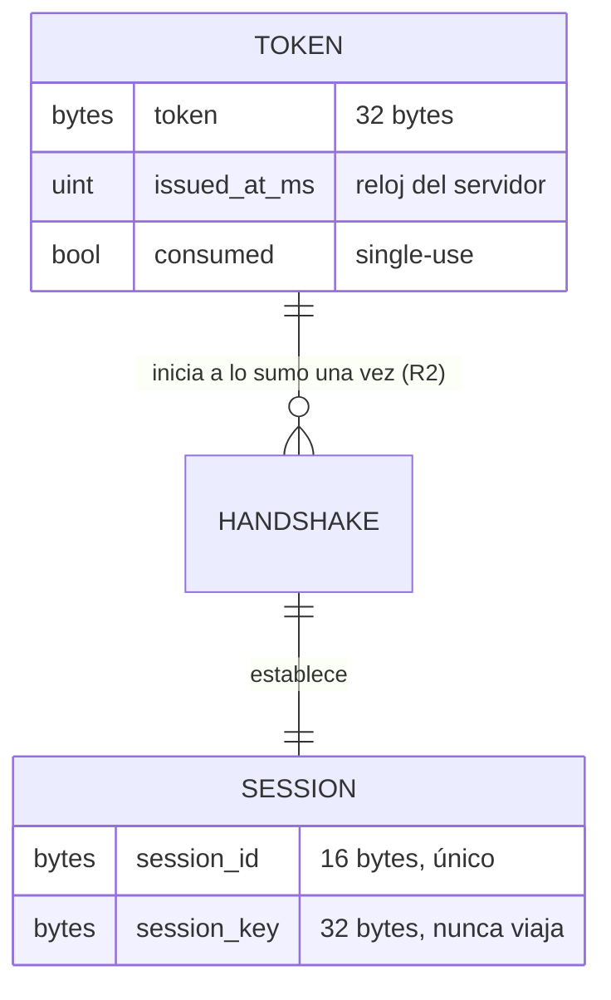
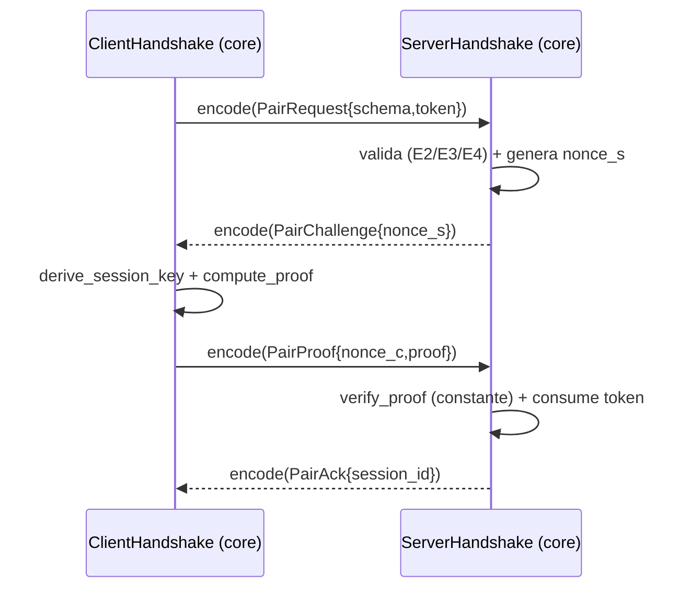

# DES-001 — Realización del protocolo de sesión (SPEC-001)

> **What this is:** how a SPEC (or a coherent group) is realized within the architecture: components touched, interfaces, data model, algorithms, error handling.
> **What it is NOT:** why an architectural alternative was chosen (see `decisions/`), or the behavior contract itself (the SPEC stays the contract).

| | |
|---|---|
| ID | DES-001 |
| Title | Realización del protocolo de Pairing y Handshake (SPEC-001) |
| Version | 0.1.0 |
| Status | `Approved` |
| Owner | Eng |
| Realizes | SPEC-001 (parcial: núcleo puro completo; adaptadores I/O diferidos — ver §14) |
| Depends on | ADR-001 (stack), ADR-002 (transporte), ADR-004 (QR + challenge) |
| Last updated | 2026-10-07 |

## 1. Overview

El protocolo de SPEC-001 se realiza como un núcleo puro en el crate `twinpad-core` (`core/`): codec del payload QR, codec NDJSON de mensajes, derivación de claves (HKDF-SHA256) y pruebas HMAC-SHA256, y dos máquinas de estado de Handshake (servidor y cliente) que no realizan I/O: reciben mensajes tipados y parámetros de entropía/reloj, y devuelven salidas tipadas. Los adaptadores con I/O (listener TCP y registro de sesiones en `server/`, escáner QR en `android/app`) se conectan por estas interfaces y se implementan en la siguiente iteración. Patrón central: máquinas de estado puras + funciones deterministas (P10/P11), Newtypes para no mezclar bytes de dominio.

## 2. Fit with the architecture

- Components touched: `Twinpad Core (PC)` (crate `twinpad-core`); futuro adaptador en `Servidor PC` (`twinpad-server`) y app Android.
- Boundary rules respected: `core/` sin I/O (ENG §5 P11, S5); el transporte (TCP LAN, ADR-002) queda en el adaptador; ninguna dependencia de Android/Windows en `core`.
- New components introduced: ninguno (solo módulos dentro de `core`).

## 3. Domain model

- `QrPayload`: value object con `server_addr: String`, `server_port: u16`, `token: Token`. Invariante: parseable desde `twinpad://v1#s=…&p=…&t=…` (SPEC-001 §4.1).
- `Token([u8;32])`, `Nonce([u8;32])`, `SessionId([u8;16])`, `SessionKey([u8;32])`: Newtypes; la clave deriva por HKDF y no sale del proceso (R5/R6).
- `HandshakeMsg`: enum de los 5 mensajes de SPEC-001 §4.2.
- `ServerHandshake` / `ClientHandshake`: estados `WaitRequest → WaitProof → Established` (servidor) y `Start → WaitAck` (cliente), con invariantes de SPEC-001 §14.

## 4. Interfaces

| Interface | Contract | Notes |
|---|---|---|
| `qr::parse(s) -> Result<QrPayload, PairError>` | estricta: esquema exacto, claves {s,p,t} sin duplicados ni extras | E5 si no cumple §4.1 |
| `qr::format(&QrPayload) -> String` | canónica, determinista (orden s,p,t) | para tests y el Servidor PC |
| `message::encode(&HandshakeMsg) -> Result<String, PairError>` | NDJSON compacto de una línea, UTF-8 | serde_json, `deny_unknown_fields` |
| `message::decode(&str) -> Result<HandshakeMsg, PairError>` | valida longitudes (nonce/proof 32 B, session_id 16 B) y `schema` | E4 |
| `crypto::derive_session_key(&Token, &Nonce) -> SessionKey` | HKDF-SHA256, ikm=token, salt=nonce_s, info=`"twinpad.v1 session"`, 32 B | pura |
| `crypto::compute_proof(&SessionKey, transcript) -> [u8;32]` | HMAC-SHA256 | pura |
| `crypto::verify_proof(&SessionKey, transcript, proof) -> bool` | comparación en tiempo constante (`hmac::verify`) | anti-timing (SPEC-001 §7.9) |
| `handshake::ServerHandshake::step(&mut self, Option<&HandshakeMsg>, now_ms, ServerEntropy)` | máquina servidor; `ServerEntropy{nonce_s, session_id}` aporta aleatoriedad del adaptador | sin I/O |
| `handshake::ClientHandshake::step(&mut self, Option<&HandshakeMsg>, now_ms)` | máquina cliente | sin I/O |
| `crypto::is_expired(issued_at_ms, now_ms) -> bool` | `now - issued > 300_000` (R3) | frontera exacta en tests |

Transcript fijo para `proof`: `encode(pair_request) ‖ encode(pair_challenge) ‖ nonce_s ‖ nonce_c` (bytes NDJSON de los dos primeros; este documento precisa el «‖» de SPEC-001 §7.8).

## 5. Data model and persistence

| Store | Schema | Migrations | Retention |
|---|---|---|---|
| (ninguno en esta iteración) | registro de tokens/sesiones vive en el adaptador de `server/` (memoria + almacén cifrado ARCH §5 en iteración posterior) | — | R3/R6 |

`core` expone tipos (`TokenRecord { token, issued_at_ms, consumed }`); la propiedad del almacén es del Servidor PC (ARCH §5, owner único).

## 6. Internal flows

- Transaction boundaries: el consumo del token ocurre solo al verificar `proof` con éxito (SPEC-001 §14).
- Consistency: un registro de token por servidor; la concurrencia se resuelve en el adaptador `server/` con exclusión mutua (§7).

## 7. Concurrency

| Concern | Approach |
|---|---|
| Dos `pair_request` con el mismo token | un `ServerHandshake` por conexión; el consumo único (R2) lo arbitra el registro del adaptador con mutex; `core` garantiza que una instancia nunca consume dos veces |
| `pair_proof` tarde (> 10 s) | timeout en `step` vía `now_ms`; vuelve a `WaitRequest` sin consumir el token (SPEC-001 §14) |
| Mensajes fuera de secuencia | cada estado solo acepta su mensaje esperado; cualquier otro → E3/E4 |

## 8. Error handling

| SPEC error | Mechanism (retry / fallback / map to X) |
|---|---|
| E1 servidor no disponible | solo adaptador TCP de `server/` (connect refused/timeout); `core` no lo produce |
| E2 token expirado | `crypto::is_expired` en el paso de `pair_request`; el adaptador muestra el QR nuevo (R7) |
| E3 rechazo de autenticación | token desconocido/consumido, proof inválido, mensaje fuera de secuencia, timeout de 10 s |
| E4 mensaje malformado | `message::decode` con serde estricto + validación de longitudes |
| E5 QR malformado | `qr::parse` con gramática estricta de §4.1 |

No se inventan errores observables nuevos: los códigos son exactamente E1–E5 de SPEC-001 §9.

## 9. Caching

No aplica (sin datos cacheados en el núcleo del protocolo).

## 10. Algorithms

| Problem | Algorithm | Complexity | Justification |
|---|---|---|---|
| Derivar clave de sesión | HKDF-SHA256 (extract+expand) | O(n) | estándar para KDF de un secreto; primitivas decididas (SPEC-001 §17 resuelta) |
| Challenge mutuo | HMAC-SHA256 sobre transcript fijo + verificación en tiempo constante | O(n) | NFR-004; evita timing attacks |
| Parseo del QR | escaneo lineal de la gramática estricta | O(n) | payload diminuto (≤ ~200 chars); claridad sobre rendimiento |
| Codificación token/nonce/session_id | base64url sin relleno (RFC 4648 §5) | O(n) | 32 B → 43 chars, 16 B → 22 chars; URL-safe |

## 11. Patterns applied

- **Newtypes** (`Token`, `Nonce`, `SessionId`, `SessionKey`): impide mezclar bytes de distinto dominio en el FFI/código.
- **Máquinas de estado puras**: el Handshake sin I/O permite tests deterministas en loopback lógico y reutilización servidor/Android.
- **Inyección de entropía/reloj**: `ServerEntropy` y `now_ms` entran por parámetro; el RNG criptográfico vive en el adaptador (ENG §5 P11).

Dependencias nuevas de `core` (revisadas según ENG §11: mantenimiento, sin `unsafe`, licencia MIT/Apache): `serde`, `serde_json`, `hmac`, `sha2`, `hkdf`, `base64`.

## 12. Traceability

| SPEC aspect | Where realized | Test |
|---|---|---|
| §4.1 payload QR (E5) | `core::qr` | TEST-006 |
| §4.2 mensajes NDJSON (E4) | `core::message` | TEST-006 |
| §7 flujo principal | `core::handshake` (par servidor/cliente) | TEST-001 |
| E2 expiración (R3) | `core::crypto::is_expired` + `handshake` | TEST-003 |
| E3 sin token/consumido/proof inválido | `core::handshake` | TEST-004 |
| R2 segundo dispositivo con el mismo QR | `core::handshake` + registro del adaptador | TEST-005 |
| E1 servidor no disponible | adaptador `server/` (diferido) | TEST-002 (pendiente de adaptador) |
| §8.2 reanudación | registro de sesiones en `server/` (diferido); `core` aporta verificación de proof | TEST-007 (pendiente de adaptador) |
| §8.3 revocación | registro de sesiones en `server/` (diferido) | TEST-008 (pendiente de adaptador) |
| R7 regeneración automática del QR | temporizador del `server/` (diferido) | TEST-009 (pendiente de adaptador) |

## 13. Related decisions

- ADR-001 — stack Kotlin/Rust: este núcleo es Rust puro, reutilizable desde Android vía FFI.
- ADR-002 — transporte: TCP sobre WiFi LAN queda fuera de `core` (adaptador).
- ADR-004 — QR + token de un solo uso + challenge mutuo: modelado tal cual en `core`.

## 14. Open questions

- Ninguna. Diferencias explícitas fuera de alcance de esta iteración: adaptador TCP de `server/` (TEST-002/007/008/009), persistencia cifrada de sesiones (ARCH §5).

## Definition of Done

- [x] Realizes a SPEC explicitly and completely (or states which parts are deferred).
- [x] Respects architecture boundaries; any deviation went through ADR + CR first.
- [x] Every SPEC error has a handling mechanism.
- [x] Concurrency and caching addressed or explicitly marked not applicable.
- [x] Traceability section maps every SPEC aspect to a component and a TEST.
- [x] No copy of the SPEC's behavior; this doc explains structure, not contract.
- [x] No placeholders; Status updated.

## Changelog

| Version | Date | Author | Change |
|---|---|---|---|
| 0.1.0 | 2026-10-07 | Twinpad team | Diseño inicial: núcleo puro del protocolo de SPEC-001; adaptadores diferidos |
