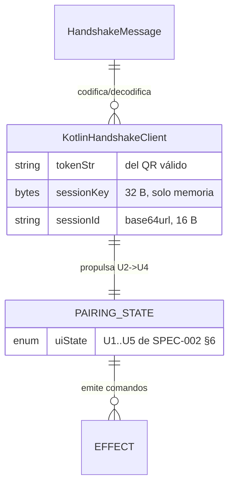
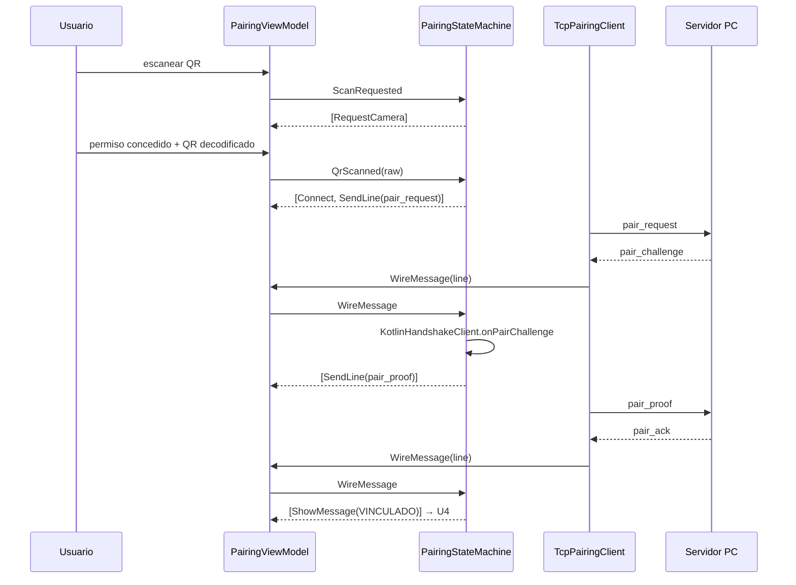

# DES-002 — Realización de la app Android de Pairing (SPEC-002)

> **What this is:** how a SPEC (or a coherent group) is realized within the architecture: components touched, interfaces, data model, algorithms, error handling.
> **What it is NOT:** why an architectural alternative was chosen (see `decisions/`), or the behavior contract itself (the SPEC stays the contract).

| | |
|---|---|
| ID | DES-002 |
| Title | Realización de la app Android de Pairing (SPEC-002) |
| Version | 0.3.5 |
| Status | `Approved` |
| Owner | Eng |
| Realizes | SPEC-002 (full: lógica de vinculación + pantallas; el render de cámara en instrumentación requiere dispositivo — ver §14) |
| Depends on | DES-001, ADR-001 (stack), ADR-002 (transporte), ADR-004 (QR + challenge) |
| Last updated | 2026-10-29 |

## 1. Overview

La lógica de vinculación vive en una máquina de estados pura en Kotlin (`PairingStateMachine`) dentro del módulo `:app`, testeada 100 % en JVM: recibe eventos (escaneo, mensajes wire, permisos, acciones del usuario) y emite comandos declarativos (abrir cámara, conectar TCP, enviar mensaje, mostrar texto). Los efectos (cámara, socket, UI) son adaptadores que obedecen comandos — el núcleo no importa clases de Android ni de red (ENG §5 P11). El Handshake del lado app se re-implementa en Kotlin puro (`KotlinHandshakeClient`) con `javax.crypto.Mac` (HmacSHA256) y HKDF sobre `Mac`, sin JNI: la frontera FFI está reservada a `hid/` y `sdk/` (ENG §2). La UI usa Views XML con dos pantallas (Pairing y cámara) sobre un único `PairingViewModel`; las cadenas de UI son recursos de strings (SPEC-002 R4). La Activity declara landscape habitual fijo y usa immersive mode para ocultar las barras del sistema. El acelerómetro y el giroscopio capturados a `SENSOR_DELAY_GAME` forman el snapshot wire `motion` con timestamp monotónico, remapeado al marco AndroidDSU de referencia landscape, exclusivo de la orientación landscape fija de la app (CR-022, CR-037); el sensor de orientación remapeado a pantalla alimenta solo el monitor local (CR-021).

## 2. Fit with the architecture

- Components touched: `App Twinpad (Android)` (módulo `:app`); la frontera con `Twinpad Core (PC)` sigue siendo el protocolo de sesión (ARCH §3).
- Boundary rules respected: sin JNI fuera de `hid/`/`sdk/` (ENG §2); sin acceso directo del app a la captura del PC; los eventos wire viajan por el transporte del adaptador.
- New components introduced: ninguno a nivel ARCH; módulos internos nuevos dentro de `:app` (`core/`, `wire/`, `ui/`).

## 3. Domain model

- `PairingUiState` (sealed): `Idle(U1)`, `Scanning(U2)`, `Handshaking(U3)`, `Linked(U4)`, `Error(U5, mensaje)`.
- `QrPayload` (Kotlin, espejo de `core::qr`): `serverAddr`, `serverPort`, `token`; parseo estricto de `twinpad://v1#s=&p=&t=` (E5).
- `HandshakeMessage` (sealed, espejo de SPEC-001 §4.2): `PairRequest`, `PairChallenge`, `PairProof`, `PairAck`, `PairError(code, message)`.
- `SessionState`: `sessionId` + `sessionKey` en memoria del proceso (SPEC-002 R6); sin persistencia.
- `GyroMonitorView`: diagnóstico visual de sensor con marco rectangular y tres ejes; consume yaw/pitch/roll de pantalla después del remapeo CR-011.
- `AndroidSettings.showGyroMonitor`: booleano persistido en `SharedPreferences`; false si no existe y modificable desde el drawer.

## 4. Interfaces

| Interface | Contract | Notes |
|---|---|---|
| `QrParser.parse(raw: String): QrPayload` | gramática de SPEC-001 §4.1; lanza `PairingError.QrInvalid` (E5) | puro, determinista |
| `HandshakeCodec.encode(msg): String` / `.decode(line: String): HandshakeMessage` | NDJSON estricto de SPEC-001 §4.2; desconocido/extra → E4 | puro |
| `KotlinHandshakeClient` | `start(tokenStr)` → `PairRequest`; `onPairChallenge(nonceS, nonceC)` → `PairProof`; `onPairAck(sid)` → `SessionState` | HKDF+HMAC con primitivas idénticas a `core::crypto` (DES-001 §4) |
| `PairingStateMachine.onEvent(e): List<Effect>` | eventos: `ScanRequested`, `CameraGranted/Denied`, `QrScanned(raw)`, `WireMessage(String?)`, `Cancelled`, `AppBackgrounded`, `Retry` | núcleo de SPEC-002 §6 |
| `Effect` (sealed) | `RequestCamera`, `StartCamera`, `StopCamera`, `Connect(addr, port)`, `Disconnect`, `SendLine(String)`, `ShowMessage(resId)`, `ShowError(resId)` | la UI/capa Android los ejecuta |
| `PairingViewModel` | une máquina + adaptador de red + cámara; expone `StateFlow<PairingUiState>` | único dueño del estado |
| Sensores de movimiento → `input_report` | `TYPE_ACCELEROMETER` + `TYPE_GYROSCOPE` a `SENSOR_DELAY_GAME` → `motion.timestamp_us`, `motion.accel` m/s² y `motion.gyro` rad/s; cada evento publica las muestras más recientes de ambos sensores. Si falta una muestra, omite `motion` hasta que ambas estén disponibles. | Snapshot independiente del monitor local; el timestamp es el máximo timestamp monotónico de sensores, convertido de ns a μs (CR-021); el remapeo al marco AndroidDSU landscape con accel `(y, -z, x)` y gyro `(-y, -z, x)` es fijo y exclusivo de la orientación landscape de la app (CR-022, CR-037). |
| Sensor de orientación → `GyroMonitorView` | `SensorManager.TYPE_ROTATION_VECTOR` → remapeo CR-011 → yaw/pitch/roll de pantalla | Solo diagnóstico local; la vista opt-in dibuja colores yaw verde, pitch rojo, roll azul y no alimenta el wire. |

## 5. Data model and persistence

| Store | Schema | Migrations | Retention |
|---|---|---|---|
| SessionState | toda la sesión vive en memoria del proceso (SPEC-002 R6) | — | proceso vivo |
| Preferencias locales | `showGyroMonitor: Boolean`, default false | ninguna | hasta que el usuario lo cambie; guardado en `SharedPreferences` |

## 6. Internal flows

- Transaction boundaries: el estado de UI cambia solo en el hilo principal al aplicar `Effect`s.
- Consistency: un intento activo a la vez (SPEC-002 R5); cancelar/fondo emiten `Disconnect`+`StopCamera`.
- CR-038: la cámara frontal (CR-034) solo se enciende con el estado combinado de la sesión — juego «cemu» seleccionado **Y** demanda vigente del mensaje `camera_request` de Cemu. La demanda vive en el `PairingViewModel` (`cameraRequested`) y la Activity la aplica con `combine(selectedGameId, cameraRequested)`, de modo que ambos órdenes de llegada activan/paran el stream; cambiar de juego o cerrar la sesión apaga la cámara y cancela la demanda.

## 7. Concurrency

| Concern | Approach |
|---|---|
| Lectura de socket bloqueante | coroutine en `Dispatchers.IO`; el hilo de UI nunca bloquea (ENG §9) |
| Mensaje llegando tras cancelación | el canal de la máquina valida el `attemptId`; mensajes de intentos viejos se descartan |
| Rotación | el `ViewModel` sobrevive; el intento continúa (SPEC-002 §10) |
| App a segundo plano | `onPause` → evento `AppBackgrounded` → aborto limpio (SPEC-002 §8.3) |

## 8. Error handling

| SPEC error | Mechanism (retry / fallback / map to X) |
|---|---|
| E1 | timeout de conexión/respuesta de 5 s en `TcpPairingClient` (coroutine con `withTimeout`); socket cerrado a mitad → E1 |
| E2/E3 | `PairError(code)` del wire → `PairingError.Expired/Rejected` → strings exactas de SPEC-002 §9 |
| E4 | fallo de `HandshakeCodec.decode` o código desconocido (≠E1–E5) → "Respuesta no válida" |
| E5 | fallo de `QrParser.parse` → "QR no válido"; sin conexión |
| PERMISO | `CameraDenied` → "Se necesita la cámara para escanear el QR" |
| SESIÓN | caída del socket en U4 → "Sesión terminada" (máquina en estado Linked) |

Sin errores observables nuevos: la tabla de strings es exactamente la de SPEC-002 §9 en `res/values/strings.xml`.

## 9. Caching

No aplica (sin datos cacheados; la sesión no persiste).

## 10. Algorithms

| Problem | Algorithm | Complexity | Justification |
|---|---|---|---|
| HKDF-SHA256 | extract+expand manual sobre `javax.crypto.Mac` (RFC 5869, 1 bloque) | O(n) | sin dependencias nuevas; vector de prueba compartido con `core` |
| Base64url | `java.util.Base64.getUrlEncoder/Decoder` sin padding | O(n) | estándar JVM |
| Parseo del QR | split determinista sobre la gramática §4.1 | O(n) | payload diminuto |

## 11. Patterns applied

- **MVI ligero (evento → comandos)**: la máquina pura permite TEST-010..014 en JVM sin Robolectric, y separa lógica de Compose.
- **Adaptador de efectos**: `Effect` como única forma de tocar cámara/socket/UI — el núcleo queda testeable y sin I/O (ENG §5 P11).
- **Same-spec parity tests**: los vectores de QR/mensajes/proof se comparten con los tests de `core` para garantizar interoperabilidad (test-strategy §10: sin mockear el protocolo).

## 12. Traceability

| SPEC aspect | Where realized | Test |
|---|---|---|
| §7 flujo completo (U2→U4) | `PairingStateMachine` + `TcpPairingClient` | TEST-010 (JVM: máquina + socket loopback real) |
| §9 E1 (timeout/conexión) | `TcpPairingClient` | TEST-011 (JVM: server que no responde en loopback) |
| §9 E5 + §8.1 PERMISO | `QrParser` + máquina | TEST-012 |
| §9 E2/E3 desde `pair_error` | máquina + codec | TEST-013 |
| §10 edge cases (cancelar, fondo, código desconocido, rotación de mensajes) | máquina | TEST-014 |
| §11 R4 strings en recursos | `res/values/strings.xml` | revisión + TEST-013 (afirma resId/texto) |
| CR-011: landscape inmersivo y marco gyro | Manifest + `PairingActivity` | TEST-059 (instrumentado en dispositivo Android) |
| CR-016/CR-021: monitor Android opt-in local y captura/serialización de muestras inerciales | `PairingActivity`, `GyroMonitorView`, `ProfileGyroController`, `InputCodec` | TEST-060, TEST-078, TEST-083 |

## 13. Related decisions

- ADR-001 — Kotlin como lenguaje de la app; JVM 17 toolchain.
- ADR-002 — TCP sobre WiFi LAN en el adaptador de red; sin transporte nuevo.
- ADR-004 — el escaneo consume el QR; sin PIN ni cuentas.

## 14. Open questions

- Ninguna abierta. Diferido explícito: escaneo de cámara con instrumentación en dispositivo (la lógica de decodificación entra como adaptador ML Kit en la iteración de hardware; TEST-010..014 cubren la lógica JVM completa), Motor HID (REQ-003), Segunda pantalla (REQ-004).

## Definition of Done

- [x] Realizes a SPEC explicitly and completely (or states which parts are deferred).
- [x] Respects architecture boundaries; any deviation went through ADR + CR first.
- [x] Every SPEC error has a handling mechanism.
- [x] Concurrency and caching addressed or explicitly marked not applicable.
- [x] Traceability section maps every SPEC aspect to a component and a TEST.
- [x] No copy of the SPEC's behavior; this doc explains structure, not contract.
- [x] No placeholders; Status updated.

## Changelog

| Version | Date | Author | Change |
|---|---|---|---|
| 0.1.0 | 2026-10-07 | Twinpad team | Diseño inicial: máquina de estados pura + adaptadores; handshake en Kotlin puro sin JNI |
| 0.2.0 | 2026-10-18 | Product owner + Twinpad team (CR-011) | Documenta orientación landscape fija, modo inmersivo y remapeo gyro de pantalla |
| 0.3.0 | 2026-10-22 | Product owner + Twinpad team (CR-016) | Añade monitor Android opt-in con preferencia persistente y render de orientación/ejes en vivo |
| 0.3.1 | 2026-10-22 | Product owner + Twinpad team (CR-018) | Envía la orientación absoluta mostrada y define colores semánticos compartidos para yaw/pitch/roll |
| 0.3.2 | 2026-10-24 | Product owner + Twinpad team (CR-021) | Separa orientación local del wire y captura ambos sensores como snapshot inercial timestamped |
| 0.3.3 | 2026-10-26 | Product owner + Twinpad team (CR-022) | El snapshot inercial se envía ya en el marco AndroidDSU: accel `(-x, -z, y)`, gyro `(x, -z, y)` |
| 0.3.4 | 2026-10-29 | Product owner + Twinpad team (CR-037) | El marco AndroidDSU pasa a landscape exclusivo de la app: accel `(y, -z, x)`, gyro `(-y, -z, x)` |
| 0.3.5 | 2026-10-29 | Product owner + Twinpad team (CR-038) | La cámara frontal se rige por demanda: `camera_request` de Cemu + juego «cemu» seleccionado canalizados como estado combinado del ViewModel; sin cambio wire de App→Servidor |
