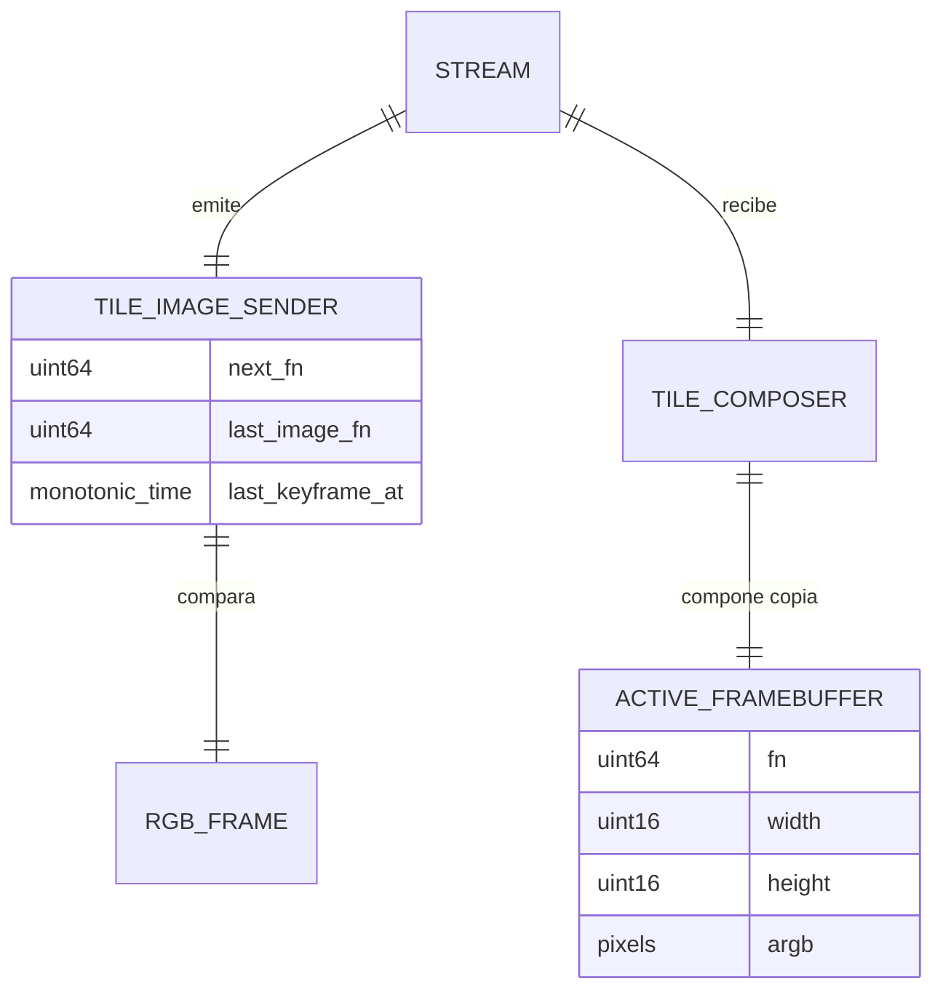

# DES-003 — Realización de video por tiles (SPEC-003 / CR-002)

| | |
|---|---|
| ID | DES-003 |
| Title | Realización del Stream de video por tiles |
| Version | 0.1.0 |
| Status | `Draft` |
| Owner | Eng |
| Realizes | SPEC-003 §4, §6–§7, §9–§10, §14 (CR-002) |
| Depends on | DES-001, ADR-005 |
| Last updated | 2026-10-17 |

## 1. Overview

El contrato wire se implementa en `twinpad-core::stream` y su par Kotlin `StreamCodec`. El servidor conserva un estado `TileImageSender` por stream, compara la imagen RGB actual con la última imagen emitida y escoge keyframe JPEG completo o un único patch con los tiles JPEG modificados. Android procesa la cola de video FIFO, valida el mensaje, decodifica todos los tiles y compone una copia de píxeles; solo publica un `Bitmap` nuevo cuando todo el lote es válido.

## 2. Fit with the architecture

- Components touched: `Twinpad Core (PC)` (`core/src/stream.rs`), `Servidor PC` (`server/src/tile_video.rs`, `server/src/video.rs`) y `App Twinpad (Android)` (`wire/StreamCodec`, `stream/TileComposer`).
- Boundary rules respected: el core define y valida el protocolo sin I/O; captura y transporte permanecen en el servidor; Android compone y presenta, sin acceder a la captura del PC.
- New components introduced: `TileImageSender` y `TileComposer` son módulos internos; no se añade dependencia externa.
- Status: `Draft` hasta la revisión del diseño y la medición de CR-002 §7. La suite local verifica contratos/algoritmos; no sustituye la validación física de NFR-001/NFR-005.

## 3. Domain model



- `TileImageSender`: propietario de la imagen RGB anterior, secuencia de imágenes emitidas y marca temporal del keyframe.
- `TileComposer`: propietario del `Bitmap` base, su `fn`, las dimensiones anunciadas y el indicador de espera de keyframe.
- `VideoTile`: rectángulo JPEG alineado a la cuadrícula de 64 px; solo el borde puede ser menor.

## 4. Interfaces

| Interface | Contract | Notes |
|---|---|---|
| `StreamMsg::VideoPatch` | SPEC-003 §4; serialización serde usa wire `fn` | validación de dimensiones, base, JPEG, cuadrícula y tiles únicos en `core::stream` |
| `TileImageSender::emit(sink, current, jpeg, ts)` | keyframe o patch según SPEC-003 §7 | estado por stream; `fn` avanza solo tras emisión satisfactoria |
| `StreamCodec.decode(line)` | par Kotlin del contrato §4 | valida header, campos y geometría; datos JPEG decodificados una sola vez |
| `TileComposer.beginStream/applyKeyframe/applyPatch` | composición según SPEC-003 §7 paso 4 | APIs internas; devuelven el nuevo Bitmap o `null` sin mutar la base ante fallo |
| `TileCompositor.compose(base, width, height, tileSize, tiles)` | operación pura sobre píxeles ARGB | copia la base; rechaza lotes inválidos/duplicados antes de componer |

El contrato público wire permanece definido exclusivamente en SPEC-003 §4.

## 5. Data model and persistence

| Store | Schema | Migrations | Retention |
|---|---|---|---|
| Memoria del emisor por stream | RGB previo, último `fn`, próximo `fn`, dimensión y reloj del keyframe | Ninguna | Se libera al terminar/cambiar origen |
| Memoria Android | Bitmap vigente, último `fn`, dimensiones y modo de recuperación | Ninguna | Se libera al `stream_stop`, corte o destrucción del ViewModel |

No hay persistencia ni migraciones.

## 6. Internal flows

```mermaid
sequenceDiagram
  participant V as Fuente RGB / SDK
  participant S as TileImageSender (server)
  participant C as core::stream
  participant N as SessionWriteLock / TCP
  participant K as FIFO video (Android)
  participant D as StreamCodec + TileComposer
  participant UI as StateFlow / vista
  V->>S: RGB actual + JPEG completo
  S->>S: comparar tiles vs imagen emitida
  alt inicio, keyframe vencido, resolución cambió o patch no ahorra
    S->>C: video_frame(fn, fmt=jpeg)
  else tiles cambiados
    S->>C: video_patch(fn, base_fn, tiles JPEG)
  else sin cambios
    S->>S: no emitir ni incrementar fn
  end
  C->>N: validar y serializar mensaje NDJSON
  N->>K: línea completa en orden
  K->>D: decodificar y comprobar base
  D->>D: validar lote; componer copia; crear Bitmap
  D-->>UI: publicar Bitmap entero y nuevo fn
```

- Transaction boundaries: un patch se considera aceptado solo tras decodificar/validar cada tile y construir una imagen completa nueva. Un fallo conserva el frame mostrado y activa espera de keyframe.
- Consistency: orden FIFO para líneas de video; el audio y los inputs se atienden directamente desde el lector de sesión. La garantía de recuperación y el formato temporal son los de SPEC-003 §7.

## 7. Concurrency

| Concern | Approach |
|---|---|
| Captura/SDK y escritor | `TileImageSender` vive en el hilo emisor por stream; no comparte estado entre sesiones |
| Lector de socket vs decodificación | El lector encola líneas de video en un canal FIFO sin límite; un consumidor Default las valida y compone para preservar `base_fn` sin bloquear audio/inputs |
| Publicación de imagen | `StateFlow` publica solo el Bitmap completo, después de terminar la composición |
| Cambio de dimensiones o stream | `stream_start` invalida y libera base; el keyframe siguiente establece la nueva base sin reiniciar la secuencia del stream |

## 8. Error handling

| SPEC error | Mechanism (retry / fallback / map to X) |
|---|---|
| Keyframe corrupto/inconsistente (§9) | se descarta; el compositor espera keyframe válido y mantiene la vista previa |
| Patch con base distinta, tile corrupto o geometría inválida (§9) | no se muta ni publica la base; se ignoran patches hasta el siguiente keyframe (≤1 s) |
| `type` desconocido/campos inválidos (§9) | el codec devuelve la violación de protocolo E4 conforme a SPEC-001/002 |
| Desconexión o `stream_stop` (§5/§6) | reset del compositor, libera Bitmap y la UI vuelve a estado inactivo |

## 9. Caching

| Cache | Invalidation | Failure mode |
|---|---|---|
| RGB anterior transmitido, server | keyframe tras intervalo, resolución/cambio de origen, cierre de stream | forzar keyframe y establecer base nueva |
| Bitmap base, Android | `stream_start`, `stream_stop`, desconexión o `onCleared` | liberar; ignorar patches hasta keyframe |

## 10. Algorithms

| Problem | Algorithm | Complexity | Justification |
|---|---|---|---|
| Diff RGB por tiles | recorrer cuadrícula fija 64×64, comparar bytes por filas; JPEG solo para tiles diferentes | O(W×H) comparación + codificación de regiones modificadas | tiles fijos y agrupación de un mensaje según CR-002 |
| Elección patch/keyframe | comparar longitud NDJSON serializada del patch contra keyframe JPEG completo | O(bytes serializados) | usa el criterio wire exacto de SPEC-003 §7 |
| Composición Android | validar todos los tiles, copiar ARGB base y reemplazar filas de cada tile en una imagen de trabajo | O(W×H + pixeles modificados) | atomicidad sin mutar el Framebuffer activo |

## 11. Patterns applied

- **Composición copy-on-write:** evita que un fallo a mitad de lote exponga una imagen parcialmente parcheada.
- **Emisor de estado por stream:** evita compartir secuencia/base entre sesiones Android distintas.

## 12. Traceability

| SPEC aspect | Where realized | Test |
|---|---|---|
| §4 contrato de `video_patch`, wire `fn`, geometría | `core::stream`, Android `StreamCodec` | TEST-027 |
| §7 diff, patch, keyframe periódico/fallback | server `TileImageSender`, Android `TileCompositor` | TEST-028 |
| §7 composición atómica y rechazo de lote | Android `TileCompositor` puro y `TileComposer` | TEST-028 |
| §9/§10 pérdida de base y recuperación | Android `TileComposer`; keyframe del server | TEST-027, TEST-028 |

## 13. Related decisions

- ADR-005 — la Segunda pantalla se representa como imágenes/framebuffers.
- CR-002 — fija la modalidad de 64 px, keyframes, base y despliegue coordinado.

## 14. Open questions

- La medición de bytes, FPS, CPU y latencia p95 requiere el banco físico Android + PC y sigue pendiente (CR-002 §3/§7, NFR-001/NFR-005).

## Definition of Done

- [x] Realizes SPEC-003 CR-002 y sus módulos explícitamente.
- [x] Respeta las fronteras core/adaptadores descritas en ARCH §3.
- [x] Errores de SPEC-003 mapeados a recuperación sin agregar errores observables.
- [x] Concurrencia, cachés y atomicidad abordadas.
- [x] Traceability enlaza TEST-027/028.
- [x] No duplica el contrato de comportamiento de SPEC-003.
- [x] Sin placeholders; este diseño permanece Draft hasta revisión del owner y mediciones del banco.

## Changelog

| Version | Date | Author | Change |
|---|---|---|---|
| 0.1.0 | 2026-10-17 | Usuario + agente | Diseño inicial de la realización de tiles bajo CR-002 |
