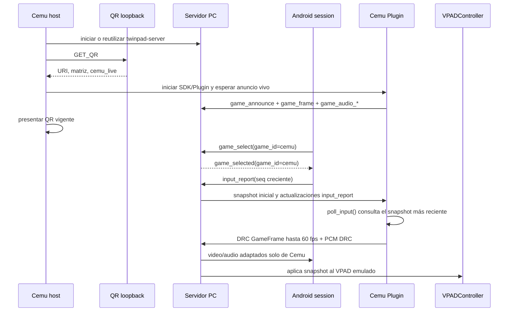

# DES-004 — Adaptador Cemu bidireccional (CR-005/CR-006/CR-007/CR-008/CR-009/CR-010)

| | |
|---|---|
| ID | DES-004 |
| Title | Realización del adaptador experimental Cemu bidireccional |
| Version | 0.6.0 |
| Status | `Draft` |
| Owner | Eng |
| Realizes | SPEC-004 §4/§7/§12; SPEC-006 §3/§4/§7/§9/§12/§16 (CR-005/CR-006/CR-007/CR-008/CR-009/CR-010) |
| Depends on | DES-003, ADR-007, ADR-008 |
| Last updated | 2026-10-18 |

## 1. Overview

Cemu es la primera integración host del Plugin SDK. El host Cemu inicia `twinpad-server` desde PATH si no existe una instancia activa, o reutiliza la que responde; consulta el QR vigente en `127.0.0.1:8423`, inicia el anuncio `cemu` y espera `cemu_live=true` antes de presentar el QR. El SDK/Plugin es headless. Al cancelar el diálogo, Cemu cancela la solicitud manual y cierra sus conexiones; auto-connect opt-in existente permanece según CR-006.

Con sesión activa, Android selecciona el Plugin por `game_id`. Cemu publica el framebuffer DRC internamente, sin ventana separada ni selector, a la tasa configurada hasta 60 fps, junto con PCM DRC. Consume snapshots `input_report` enviados por el Servidor al seleccionar y al actualizarse. El Servidor solo adapta/retransmite fuentes de Plugin; nunca captura escritorio, genera demo ni sintetiza audio.

## 2. Fit with the architecture

- Components touched: Adaptador experimental Cemu y Servidor PC.
- Boundary rules respected: app → sesión autenticada → servidor → IPC localhost; Cemu no accede a la sesión LAN ni elude Pairing. El endpoint QR se enlaza a `127.0.0.1` solamente.
- New components introduced: endpoint TCP de consulta local del QR en el Servidor PC; `TwinpadClient` lanza/reutiliza y dibuja la respuesta en Cemu.

## 3. Domain model

- `TwinpadInputState`: último snapshot válido y secuencia recibido del Servidor; se reinicia al terminar la conexión del título.
- `Cemu host lifecycle`: inicia/reutiliza el Servidor PC, anuncia `cemu` y presenta QR; la conexión SDK se mantiene por título bajo las preferencias Cemu existentes.
- `twinpad_auto_connect`: preferencia persistente Cemu, false por defecto.
- `VPADStatus_t`: recibe el estado Twinpad más reciente mientras el Plugin Cemu es el destino seleccionado; controles locales no se combinan.
- `DRC source`: textura GamePad publicada por el adaptador a la tasa configurada del stream, máximo 60 fps; Separate GamePad View permanece independiente.

## 4. Interfaces

| Interface | Contract | Notes |
|---|---|---|
| Host Cemu → Servidor PC | Inicio/reutilización del proceso y consulta QR, CR-010 / SPEC-006 | QR loopback `127.0.0.1:8423`; espera `cemu_live=true` antes de mostrar |
| Android session → Servidor PC | SPEC-004 `input_report`; SPEC-006 `game_select` | sesión autenticada, selección por `game_id` |
| Servidor PC → Cemu Plugin | SPEC-006 `input_report` snapshot por NDJSON/LF | conexión primaria IPC; snapshot inicial + cada actualización aceptada |
| Cemu → Servidor PC | SPEC-006 `game_announce`, `game_frame` | TCP localhost NDJSON; fuente DRC, fps configurado ≤60 |
| Cemu audio → Servidor PC | SPEC-005 / SPEC-006 `game_audio_*` | PCM DRC por canal IPC de audio existente |
| Servidor PC → Android | SPEC-003 / SPEC-005 | únicamente si el Plugin Cemu está confirmado para la sesión |

## 5. Data model and persistence

| Store | Schema | Migrations | Retention |
|---|---|---|---|
| Estado del adaptador | `TwinpadInputState` + último `seq` en memoria | Ninguna | Reiniciado al conectar/desconectar o salir del título |
| Propiedad de input server | `Option<SessionId>` en memoria | Ninguna | Hasta desconexión de la sesión |

## 6. Internal flows

Cada frame/audio/input mantiene el framing NDJSON documentado en SPEC-006. Si se elige otra fuente o Cemu deja de estar vivo, el Servidor termina los streams Cemu y la app procesa la lista vigente.

## 7. Concurrency

| Concern | Approach |
|---|---|
| Inicio/reutilización del servidor y presentación QR | El host Cemu reutiliza el proceso local o lo inicia; consulta loopback y espera el anuncio Cemu antes de presentar QR |
| Lectura/escritura IPC primary | TCP full-duplex; líneas NDJSON atómicas con LF |
| Captura DRC, inputs y polling | La publicación DRC y el polling SDK no esperan por el socket Android; el snapshot input se protege con lock corto |
| Audio/video/input sobre LAN | El Servidor serializa cada línea de sesión y mantiene prioridad input > video > audio |
| Cambio de fuente | el estado de selección por sesión controla video/audio y el Plugin destino de input |

## 8. Error handling

| SPEC error | Mechanism |
|---|---|
| Servidor ausente o reiniciado | reconectar y re-anunciar cada 2 s mientras el título permanezca activo |
| EOF, framing inválido o error de socket | marcar desconectado, descartar buffer parcial, resetear estado de input y reintentar |
| `seq` repetido/antiguo | descartar el reporte sin alterar VPAD |
| Sin título activo | “Iniciar conexión” está deshabilitado; cerrar sockets al salir del título y no reintentar hasta nueva solicitud válida |
| Auto-connect desactivado | no iniciar al comenzar títulos; solicitud manual sigue disponible |
| Auto-connect desactivado mientras conexión activa | conservar la conexión actual y aplicar la preferencia al próximo título |
| No existe servidor local | lanzar `twinpad-server` desde PATH y reintentar QR hasta 3 s; si falla, mostrar error y no solicitar adaptador |
| QR IPC inaccesible/malformado | descartar respuesta, mostrar error observable y no solicitar conexión |
| Cierre Cemu con proceso servidor propio | preguntar si detener el proceso iniciado por Cemu; no detener una instancia reutilizada |

## 9. Caching

| Cache | Invalidation | Failure mode |
|---|---|---|
| Último `TwinpadInputState` | nuevo socket, EOF o stop | regresar a controles locales luego de desconectar |
| Buffer NDJSON parcial | LF procesa línea; límite excedido/EOF lo descarta | desconectar y reintentar |

## 10. Algorithms

| Problem | Algorithm | Complexity | Justification |
|---|---|---|---|
| Enmarcado NDJSON | acumular bytes, extraer cada línea LF y parsear JSON completo | O(n) bytes | TCP no preserva límites de mensaje |
| Mapeo sticks | `int8 / 127.0f`, invertir Y para convención VPAD | O(1) | conserva rango −1…1 |
| Mapeo de touch | escalar 0…65535 a rectángulo TP del VPAD; al soltar conservar posición | O(1) | coincide con el rango de touch definido |

## 11. Patterns applied

- **Snapshot de estado:** el VPAD no toma locks de red ni depende del framing/socket.

## 12. Traceability

| SPEC aspect | Where realized | Test |
|---|---|---|
| SPEC-004 touch/orientación y serialización | `core::input`, Kotlin `InputCodec` | TEST-043 |
| SPEC-006 selección por sesión y relay A/V | `GameRegistry`, handler de sesión, escritor de streams | TEST-051 |
| SPEC-004/006 snapshot inicial, retención y polling SDK | sesión PC, IPC primary, `TwinpadGame::poll_input` | TEST-052 |
| SPEC-002 selección Android única/múltiple y liveness | `PairingViewModel`, `PairingActivity` | TEST-053 |
| Cemu host inicia/reutiliza Server, presenta QR, DRC ≤60 fps y PCM | `TwinpadClient`, renderer Cemu y server relay | TEST-054; build/E2E físico pendiente |
| Ciclo Cemu anterior, configuración y QR loopback | `MainWindow`, `TwinpadClient`, listener QR | TEST-046, TEST-047, TEST-050 |

## 13. Related decisions

- CR-004 — integración experimental Cemu; sus límites iniciales de 5 fps fueron reemplazados por CR-010.
- CR-005 — retry 2 s tras inicio y mapeo directo; el fallback de video fue supersedido por CR-010.
- CR-006 — preferencia persistente opt-in, start manual y menú de dos opciones.
- CR-007 — inicio/reutilización del Servidor PC desde Cemu, consulta QR solo loopback y pregunta por detener el proceso propio al cerrar.
- CR-008 — captura interna automática del DRC, sin ventana separada ni selección de pantalla; su máximo histórico de 5 fps fue supersedido por CR-010 (hasta 60 fps configurados).
- CR-009 — Cemu se anuncia antes de presentar QR; cancelación limpia y captura desktop limitada a pruebas explícitas.
- ADR-007 — primera ruta de inputs por sesión LAN autenticada.
- ADR-008 — IPC localhost TCP NDJSON.

## 14. Open questions

- Ninguna para el alcance aprobado por CR-010. La validación física Cemu/Android, medición de hasta 60 fps y sincronía A/V dentro de ±150 ms permanecen como gates de banco.

## Definition of Done

- [x] Realizes SPEC-004 y SPEC-006 dentro del alcance CR-005.
- [x] Respeta la frontera sesión autenticada → servidor → IPC localhost.
- [x] Retry, desconexión, secuencia y framing descritos.
- [x] Auto-connect persistente opt-in y conexión manual descritos (CR-006).
- [x] Menú Twinpad descrito con “Iniciar conexión” y “Configuraciones”.
- [ ] Probar visualmente ventana de ajustes, persistencia y conexión en vivo en Cemu.
- [x] TEST-043/044, TEST-046/047 y TEST-051…054 registrados en trazabilidad.
- [x] Rust tests/Clippy, Android unit tests y build Cemu (`CemuBin`) verificados.
- [ ] Banco físico Cemu + Android: confirmar hasta 60 fps efectivos y desfase A/V ≤ ±150 ms.

## Changelog

| Version | Date | Author | Change |
|---|---|---|---|
| 0.1.0 | 2026-10-18 | Product owner + Twinpad team | Diseño inicial para CR-005 aprobado |
| 0.2.0 | 2026-10-18 | Product owner + Twinpad team (CR-006) | Preferencia auto-connect opt-in, inicio manual, actualización en vivo y menú Twinpad |
| 0.3.0 | 2026-10-18 | Product owner + Twinpad team (CR-007) | Inicio/reutilización del Servidor PC, QR vigente presentado en Cemu y gestión de ciclo del proceso propio |
| 0.4.0 | 2026-10-18 | Product owner + Twinpad team (CR-008) | Readback DRC interno y automático independiente de la ventana separada; límite 5 fps, sin selección de pantalla |
| 0.5.0 | 2026-10-18 | Product owner + Twinpad team (CR-009) | Anunciar Cemu y confirmar su disponibilidad antes de mostrar QR; cancelar conexión manual y dejar desktop solo para pruebas |
| 0.6.0 | 2026-10-18 | Product owner + Twinpad team (CR-010) | Host Cemu inicia/reutiliza servidor y presenta QR; DRC hasta 60 fps; relay de fuente seleccionada y polling del snapshot input |
