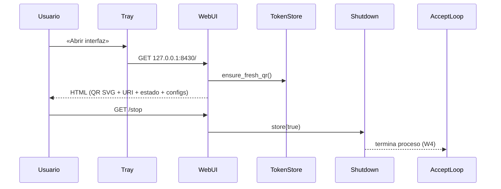

# DES-005 — Diseño de la interfaz local del Servidor PC (SPEC-010)

| | |
|---|---|
| ID | DES-005 |
| Title | Interfaz local del Servidor PC: tray + página HTTP loopback |
| Version | 0.4.1 |
| Status | `Approved` (CR-061; CR-063 apertura en webview del sistema) |
| Owner | Eng lead |
| Realizes | SPEC-010 (full) |
| Depends on | DES-001, ADR-010 |
| Last updated | 2026-11-04 |

## 1. Overview

Dos componentes nuevos en el adaptador ejecutable del Servidor PC
(crate `twinpad-server`, sin tocar `twinpad-core`):

- `server/src/tray.rs` — hilo de bandeja con `ksni` (StatusNotifierItem
  puro-Rust sobre D-Bus/zbus). Menú: «Abrir interfaz», «Mostrar URI
  (terminal)», «Iniciar al arrancar el equipo» (casilla), «Detener
  servidor». Fail-soft: si el spawn falla, solo log y sin bandeja.
  «Abrir interfaz» (CR-063 0.2.0) lanza la página en el WEBVIEW del
  sistema: `flatpak-spawn --host python3 -c <script> URL` crea una
  `Gtk.Window + WebKit2.WebView` (WebKitGTK 4.1) en el escritorio del
  HOST (el binario corre en sandbox Toolbx sin GTK/WebKit; el host
  Fedora ya trae python3-gobject + webkit2gtk4.1). Cascada de fallback:
  `--app=URL` del Blink local/host → `xdg-open`/`gio open` (local/host).
  El arranque del server abre la ventana UNA vez por sí mismo
  (`main.rs`, fail-soft; CR-063 §2 0.1.1).
- `server/src/webui.rs` — hilo HTTP artesanal (std::net) en
  `127.0.0.1:WEBUI_PORT` (defecto 8430). `GET /` renderiza una página
  HTML estática con datos vivos (QR, URI, sesiones, juegos,
  resolución/bitrate); `GET /stop` activa el flag de parada compartido.
  `GET /qr` (CR-073 0.4.0) responde JSON `{uri, ttl_ms, svg}` del MISMO
  token vigente (W8) para el contador y la regeneración sin recargar
  (W9): 503 fail-soft si el SVG no es renderizable. `GET /qr/rotate`
  (CR-073 0.2.0) ROTA el token para «Regenerar QR»: invalida el vigente
  no consumido (`tokens::rotate_qr`, reutiliza §8.3) y emite uno nuevo.
  El markup vive como assets compilados (CR-063 0.2.1):
  `server/ui/index.html` + `server/ui/styles.css` inyectados con
  `include_str!` (tokens `__*__` sustituidos por datos vivos; sin
  HTML/CSS inline en Rust, sin rutas HTTP nuevas para la hoja: el CSS
  viaja inline en el `<style>` de la misma página).
- `server/src/autostart.rs` — instala/elimina el desktop entry XDG en
  `~/.config/autostart/twinpad-server.desktop`.

El QR renderizado en la página no usa dependencias nuevas: se reutiliza
`server::qr_render::encode_matrix` (matriz 0/1 del URI) y se compone en
SVG inline dentro del HTML.

## 2. Fit with the architecture

- Components touched: adaptador ejecutable del Servidor PC (`server`),
  capa de presentación; `twinpad-core` sin cambios.
- Boundary rules respected: la UI no lógica de protocolo; solo lee del
  `TokenStore` y del `SessionRegistry` existentes vía referencias `Arc`.
- New components introduced: `tray`, `webui`, `autostart` (módulos del
  mismo crate; decisión registrada en ADR-010).

## 3. Domain model

Sin entidades nuevas de dominio: consume los existentes (Token vigente,
Sesión activa, Juego compatible). El estado compartido es el flag
`shutdown: Arc<AtomicBool>` del proceso más los callbacks de estado.

## 4. Interfaces

| Interface | Contract | Notes |
|---|---|---|
| `webui::spawn_webui(listener, ctx)` | hilo; `ctx` = uref al `TokenStore` + `SessionRegistry` + `VideoConfig` del plugin + `Arc<AtomicBool>` de parada + modo autostart | bloqueante `std`-only; una conexión por petición |
| `UiDeps.current_uri` | `Fn() -> (uri, ttl_ms_restantes)` | reutiliza `ensure_fresh_qr_with_ttl` (tokens.rs, CR-073): ciclo R7 intacto (W8) |
| `UiDeps.rotate_uri` | `Fn() -> (uri, ttl_ms_restantes)` | reutiliza `tokens::rotate_qr` (tokens.rs, CR-073 0.2.0): invalida el vigente y emite nuevo (W9 manual) |
| `tray::spawn_tray(ctx)` | `Result<(), TrayError>` (fail-soft en caller) | `ksni::blocking`; callback de menú invoca acciones compartidas |
| `autostart::install() / remove() / is_installed()` | idempotentes (SPEC-010 W5) | ruta `$XDG_CONFIG_HOME/autostart` (fallback `~/.config/autostart`) |
| `shutdown flag` | `Arc<AtomicBool>`; el accept-loop de control lo consulta | semántica W4 |

## 5. Data model and persistence

| Store | Schema | Migrations | Retention |
|---|---|---|---|
| Desktop entry | INI `twinpad-server.desktop` (Exec/Type/Comment/Terminal=false) | n/a | vida del toggle |

## 6. Internal flows

- Consistency: snapshot por petición; los datos (sesiones/juegos) son
  estables salvo cambios concurrentes, aceptables para presentación.
- Continuidad del QR (CR-073 W9): la página consulta `GET /qr` al
  vencer el contador O con «Regenerar QR», y sustituye QR y casilla del
  URI juntos con el token de esa respuesta; fail-soft conservando el
  vigente si la consulta falla o responde 503.

## 7. Concurrency

| Concern | Approach |
|---|---|
| Accept-loop de control vs parada | timeout de 500 ms en `accept` (socket2 con nonblocking + poll) para checar el flag |
| Lecturas concurrentes del store | `TokenStore`/`SessionRegistry` ya son internamente sincronizados (`Mutex`) |
| Tray callback vs hilo ksni | acciones solo tocan flag/comandos compartidos (`Arc`), sin locks largos |

## 8. Error handling

| SPEC error | Mechanism |
|---|---|
| Puerto local ocupado (E1) | log + sin página; el resto sigue (W7) |
| Sin host de bandeja (E4) | `spawn_tray` falla → log, servidor continúa |
| Autostart no escribible (E5) | `install()` devuelve error → log en el toggle |

## 9. Caching

No aplica (cada petición re-lee estado; W8 exige frescura por consulta).

## 10. Algorithms

| Problem | Algorithm | Complexity | Justification |
|---|---|---|---|
| QR SVG en página | matriz de `encode_matrix` → `<rect>` por módulo oscuro | O(n²) | n ≤ 45 módulos; sin dep. de render |
| TTL restante del QR vigente | `issued_at_ms + QR VALIDITY_MS − now` (saturado, máx 300 000) | O(1) | contador de la página (W9, CR-073; reutiliza R3 frontera exacta) |
| Poll del accept | `set_nonblocking` + `poll` de socket2 con deadline de 500 ms | O(1) por tick | sin async runtime |

## 11. Patterns applied

- **Fail-soft en periferia (W7):** los fallos de presentación nunca
  impiden el servicio de sesión.
- **Injection of effects:** los puertos de tiempo/aleatoriedad siguen
  siendo los de `main.rs`; `webui` es trivialmente testeable porque solo
  depende de los stores compartidos.

## 12. Traceability

| SPEC aspect | Where realized | Test |
|---|---|---|
| W2/W8 (página: QR+URI+estado+configs) | `webui::render_page` | TEST-0135 |
| W9 (continuidad del QR: contador + regeneración sin recargar) | `webui` ruta `/qr` (`qr_payload`) + contador cliente de `server/ui/index.html` | TEST-0146 + manual (owner) |
| W9 manual («Regenerar QR» rota el token) | `webui` ruta `/qr/rotate` + `tokens::rotate_qr` | TEST-0147/0148 + manual (owner) |
| W4 (stop con gracia) | `webui` `/stop` + flag + menú tray | TEST-0136 |
| W5 (autoarranque idempotente) | `autostart::install/remove/is_installed` | TEST-0137 |
| W6 (solo loopback) | bind estricto a 127.0.0.1 | TEST-0135 (bind + aserción) |
| W1/W3/W7 | `tray.rs` fail-soft + acciones | TEST-0141 (argv modo app) + manual (bandeja del owner) |

## 13. Related decisions

- ADR-010 — tray StatusNotifier + página loopback artesanal, sin
  framework web ni runtime async.

## 14. Open questions

- Empaquetado como servicio de sistema (systemd user unit) como
  alternativa al desktop entry — owner: Eng lead — abierto (no bloquea).

## Definition of Done

- [x] Realizes SPEC-010 completamente.
- [x] Respects architecture boundaries (sin core).
- [x] Every SPEC error has a handling mechanism.
- [x] Concurrency addressed; caching n/a.
- [x] Traceability maps W2/W4/W5/W6/W7 a TEST.
- [x] No copy of the SPEC's behavior.

## Changelog

| Version | Date | Author | Change |
|---|---|---|---|
| 0.1.0 | 2026-11-01 | Buffy (agente) | Initial (CR-061) |
| 0.2.0 | 2026-11-02 | Buffy (agente) | `Approved` — la action «Abrir interfaz» abre ventana web del sistema (`--app` Blink, fallback `xdg-open`); CR-063; TEST-0141 |
| 0.3.0 | 2026-11-02 | Buffy (agente) | `Approved` — la ventana es el WEBVIEW del sistema (WebKitGTK del host vía flatpak-spawn+PyGObject); navegadores bajan a fallback; TEST-0141/0142 |
| 0.3.1 | 2026-11-02 | Buffy (agente) | UI como assets compilados: server/ui/index.html + styles.css inyectados con include_str! en webui (sin HTML/CSS inline en Rust); sin cambio de comportamiento (TEST-0135 intacto) |
| 0.4.0 | 2026-11-04 | Buffy (agente) | Ruta GET /qr (JSON uri+ttl_ms+svg del mismo token, W8) + contador y regeneración sin recargar en la página (dashboard de 2 columnas); CR-073; TEST-0146 |
| 0.4.1 | 2026-11-04 | Buffy (agente) | «Regenerar QR» con rotación real: GET /qr/rotate + tokens::rotate_qr (invalida el vigente y emite nuevo; vencimiento automático sin rotación); CR-073 0.2.0; TEST-0147/0148 |
