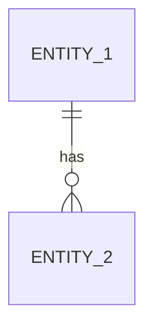
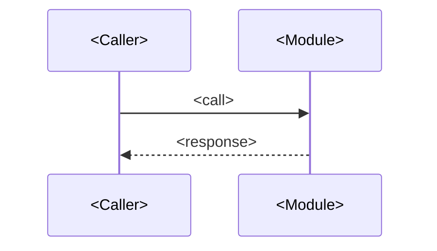

# DES-XXX — <Diseño de <SPEC-XXX o capacidad>>

> ⚠️ TEMPLATE — replace every `<placeholder>`, delete guidance blocks (`> 💡 …`) and this note before `Approved`.

> **What this is:** how a SPEC (or a coherent group) is realized within the architecture: components touched, interfaces, data model, algorithms, error handling.
> **What it is NOT:** why an architectural alternative was chosen (see `decisions/`), or the behavior contract itself (the SPEC stays the contract).

| | |
|---|---|
| ID | DES-XXX |
| Title | `<name>` |
| Version | 0.1.0 |
| Status | `Draft / In review / Approved / Superseded / Deprecated` |
| Owner | `<role>` |
| Realizes | SPEC-XXX (full / partial) |
| Depends on | DES-YYY, ADR-ZZZ |
| Last updated | `<YYYY-MM-DD>` |

## 1. Overview

> 💡 3–6 sentences: which components are touched and the core approach. No code yet, but name concrete modules/patterns (Kotlin module, crate Rust, etc.).

<Approach summary.>

## 2. Fit with the architecture

> 💡 Show the design respects architecture boundaries (§3 of architecture.md). If it needs a new dependency direction or a new component, that is an architecture change → ADR + CR first.

- Components touched: `<list>`
- Boundary rules respected: `<which>`
- New components introduced: `<list>` / none

## 3. Domain model

> 💡 Entities, value objects, invariants, relationships. Mermaid ER or class diagram + brief prose. Concepts already in the CTX glossary must keep their names (Sesión, Framebuffer, Signature HID, Config externa…).

- `<Entity>: <role, invariants>`

## 4. Interfaces

> 💡 Internal interfaces (Kotlin APIs, Rust traits/FFI boundary between Kotlin y Rust, protocolos entre módulos). Public wire contracts are NOT redefined here — reference the SPEC's contract source.

| Interface | Contract | Notes |
|---|---|---|
| `<interface>` | `<signature / schema ref>` | `<semantics, threading>` |

## 5. Data model and persistence

> 💡 Concrete schemas owned by this design (ej: configs de controles, perfiles por juego, tokens de sesión). Arch ownership rules (architecture.md §5) stay valid.

| Store | Schema | Migrations | Retention |
|---|---|---|---|
| `<store>` | `<tables/collections/indices>` | `<tool/policy>` | `<if new>` |

## 6. Internal flows

> 💡 Sequence of calls across modules for the SPEC's main and key alternative flows. Mermaid sequence diagram + notes on transactions and consistency.

- Transaction boundaries: `<where>`
- Consistency model: `<strong / eventual, and what that means here>`

## 7. Concurrency

> 💡 If the SPEC touches shared state: locking, idempotency keys, retries, race conditions considered (ej: streams concurrentes video/audio/inputs, reconexión). Delete if not applicable.

| Concern | Approach |
|---|---|
| `<concurrent writes / duplicate delivery>` | `<approach>` |

## 8. Error handling

> 💡 Map each SPEC error (SPEC §9) to a mechanism. Do not invent new observable errors — the SPEC owns observable behavior.

| SPEC error | Mechanism (retry / fallback / map to X) |
|---|---|
| `<code>` | `<mechanism>` |

## 9. Caching

> 💡 What, where, invalidation, failure mode (ej: framebuffers en tránsito, configs cargadas). Delete if not applicable.

| Cache | Invalidation | Failure mode |
|---|---|---|
| `<what>` | `<event / TTL>` | `<behavior on miss/failure>` |

## 10. Algorithms

> 💡 For non-trivial logic: name the algorithm, complexity, why it suffices (ej: captura de framebuffer, jitter buffer de audio, mapeo táctil→HID). Trivial logic needs nothing here.

| Problem | Algorithm | Complexity | Justification |
|---|---|---|---|
| `<problem>` | `<algorithm>` | `<O(...)>` | `<why sufficient>` |

## 11. Patterns applied

> 💡 Only non-obvious patterns, with why. Pattern-dropping adds noise, not clarity.

- `<pattern>`: `<why needed here>`

## 12. Traceability

| SPEC aspect | Where realized | Test |
|---|---|---|
| `<SPEC §n / flow / rule R1>` | `<component / module>` | TEST-XXX |

## 13. Related decisions

- ADR-XXX — `<what it decides for this design>`

## 14. Open questions

- `<question — owner — date — resolution>`

## Definition of Done

- [ ] Realizes a SPEC explicitly and completely (or states which parts are deferred).
- [ ] Respects architecture boundaries; any deviation went through ADR + CR first.
- [ ] Every SPEC error has a handling mechanism.
- [ ] Concurrency and caching addressed or explicitly marked not applicable.
- [ ] Traceability section maps every SPEC aspect to a component and a TEST.
- [ ] No copy of the SPEC's behavior; this doc explains structure, not contract.
- [ ] No placeholders; Status updated.

## Changelog

| Version | Date | Author | Change |
|---|---|---|---|
| 0.1.0 | `<YYYY-MM-DD>` | `<author>` | Initial draft |
